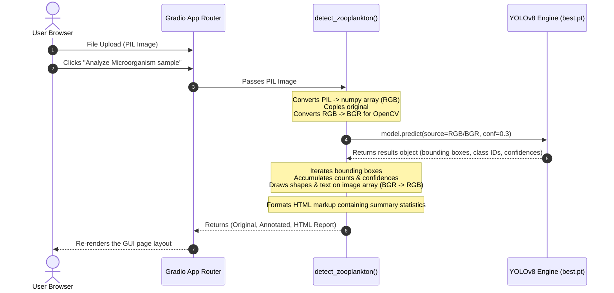
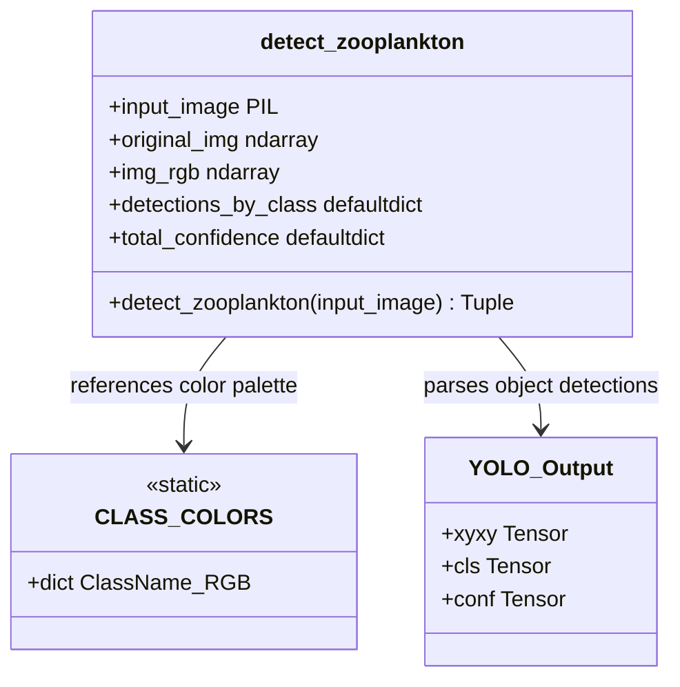

# 🌊 Marine AI - System Discovery & Codebase Assessment

This document contains a comprehensive analysis of the **Marine AI - Embedded Intelligent Microscopy System** codebase. This report evaluates the repository architecture, code components, features, performance bottlenecks, and the operational readiness of the platform.

---

## Phase 1 — Repository Discovery

### 1. Product Purpose
Marine AI is an offline-capable, embedded AI platform designed to automate the scanning, taxonomic identification, and enumeration of marine zooplankton from microscopic images. Traditional methods rely on manual human inspection under a microscope, taking 10 to 20 minutes per sample. Marine AI aims to reduce this processing time to under 20 seconds, allowing for cost-effective marine biodiversity monitoring directly on vessels or in remote coastal laboratories.

### 2. Target Users
*   **Marine Ecologists & Biologists**: Conducting field researches and spatial distribution mapping.
*   **Aquaculture & Fishery Operators**: Monitoring water biology, plankton abundance, and early detection of harmful algal blooms (HABs).
*   **Environmental Regulators**: Conducting coastal ecosystem assessments.
*   **Educational Institutions**: Cheap scientific microscopy tool for students and educators.

### 3. Core Workflows
1.  **Image Sourcing**: Capturing microscopy frames using a USB digital microscope or uploading existing high-definition images.
2.  **Inference Execution**: Subjecting the raw sample to a custom-trained YOLOv8 object detection model.
3.  **Visualization & Diagnostics**: Overlaying label-specific colored bounding boxes onto identified organisms.
4.  **Count Consolidation**: Accumulating count statistics and average prediction confidence scores grouped by taxonomic class.
5.  **Analytics Presentment**: Generating a summary and detailed HTML-styled card detailing the abundance metrics.

### 4. Main Features
*   **Deep Learning Inference**: Integrated YOLOv8 model capable of multi-scale, multi-class object detection.
*   **Microorganism Annotation**: Custom OpenCV utility drawing boundaries and color-coded labels directly on image pixels.
*   **Gradio Web Interface**: A clean, single-page, web-accessible dashboard mapping visual controls to backend models.
*   **Automated Sounding**: Dynamic port selector seeking open socket ports at runtime.

### 5. Technology Stack
*   **Model Framework**: `ultralytics` YOLOv8, running atop `PyTorch`.
*   **UI Framework**: `Gradio v4` (with integrated soft theme styles and custom CSS injections).
*   **Computer Vision**: OpenCV (`cv2`), `Pillow` (PIL).
*   **Data Processing**: `numpy`.
*   **Hardware Profiling Dependencies**: `psutil` (included in dependencies but unused in active code).
*   **Planned/Optional Integrations**: `TensorFlow`, `onnx`, `onnxruntime` (for TFLite export), `Flask` (for dashboard embedding), and Raspberry Pi specific dependencies (`picamera2`, `gpiozero`).

### 6. Architectural Layers

```
┌─────────────────────────────────────────────────────────────────┐
│                    CLIENT BROWSER (Gradio UI)                   │
├────────────────────────────────┬────────────────────────────────┤
│       Control Column           │        Display Column          │
│ - File Upload / Inputs         │ - Before / After Images        │
│ - "Analyze Microorganism" Btn  │ - HTML Analysis Summaries      │
└────────────────────────────────┼────────────────────────────────┘
                                 │ HTTP POST REST API (Gradio Websocket)
                                 ▼
┌─────────────────────────────────────────────────────────────────┐
│                     BACKEND LOGIC (app.py)                      │
│                                                                 │
│  ┌───────────────────────────────────────────────────────────┐  │
│  │                    Web Server Launcher                    │  │
│  │ - Port finder, Gradio blocks layout, component bindings   │  │
│  └─────────────────────────────┬─────────────────────────────┘  │
│                                │                                │
│                     Inference Request Flipped                   │
│                                ▼                                │
│  ┌───────────────────────────────────────────────────────────┐  │
│  │                  detect_zooplankton Engine                │  │
│  │ - cv2 Image read & color spacing conversions              │  │
│  │ - YOLOv8 forward pass (Conf threshold: 0.3)               │  │
│  │ - Bounding box annotations and label prints               │  │
│  │ - Stats accumulator (Counts & Confidence averages)         │  │
│  │ - HTML Report generation formatter                        │  │
│  └─────────────────────────────┬─────────────────────────────┘  │
│                                │                                │
│                                ▼                                │
│  ┌───────────────────────────────────────────────────────────┐  │
│  │                     Models Directory                      │  │
│  │ - D:\Marine-AI\models\best.pt (YOLOv8 Weights)            │  │
│  └───────────────────────────────────────────────────────────┘  │
└─────────────────────────────────────────────────────────────────┘
```

---

## Phase 2 — Architecture Analysis

### 1. Request, Execution, and Data Flow



### 2. State & Data Layer Isolation
*   **Application entry point**: `app.py`.
*   **API layer**: Auto-managed by Gradio via localized endpoints mapped internally through FastAPI.
*   **State Management**: Completely **stateless**. Every inference request gets evaluated independently. Raw upload streams map into RAM variables, which are cleaned upon sending response payloads. No files/uploads are permanently cached, and no session states are maintained.
*   **Database access layer**: **None**.
*   **External integrations**: **None**. The project is designed to run in internet-deprived (offline) field settings.
*   **AI integrations**: YOLOv8 weights file `best.pt` runs local inference on CPU (optionally GPU if CUDA is available).
*   **Background jobs**: **None**. All inference calls act as synchronously blocked activities.
*   **Security mechanisms**: Standard local binding structure. Security is based on the isolation of the interface within local subnets (no built-in authorization, authentication, or input sanity mechanisms are active).

---

## Phase 3 — Feature Discovery

The codebase implements three functional capabilities:

| Feature Name | Function/Purpose | User Flow | Relevant Files | Execution Status | Key Dependencies |
| :--- | :--- | :--- | :--- | :--- | :--- |
| **Object Detection & Annotations** | Draws bounding boxes and labels onto the image to highlight zooplankton classes. | Uploads image -> Clicks "Analyze" -> Views "Before" vs "After" boxes. | `app.py` | Fully functional, but contains hardcoded model path. | `cv2`, `numpy`, `ultralytics` |
| **Abundance & Confidence Analytics** | Generates tabular summaries showing dominant species and confidence levels per class. | Displays on the dashboard summary card after analysis completion. | `app.py` | Completed. | `numpy`, `collections.defaultdict` |
| **Dynamic Socket Port Binding** | Searches local networking interfaces for open TCP ports to startup. | Launches application. Console displays port values. | `app.py` | Completed. | `socket`, `contextlib.closing` |

---

## Phase 4 — Database Analysis

There is **no database** (SQL/NoSQL) running inside the system. 
The application manages data structures entirely in-memory during inference execution.

### Conceptual Data Structure Mapping



---

## Phase 5 — Code Quality Review

### 1. Critical Engineering Defects & Technical Debt
*   **Absolute Localized Path (Critical Bug)**
    Line 34: `model_path = r"D:\Marine-AI\models\best.pt"`
    This path is hardcoded to a specific local drive. If the project runs from any other drive (like `C:\Users\divye\Desktop\Marine_AI\`), it fails to locate the model and throws a GUI error card instead.
    *   *Correction Plan*: Refactor path to base relative system:
        ```python
        base_dir = os.path.dirname(os.path.abspath(__file__))
        model_path = os.path.join(base_dir, "models", "best.pt")
        ```
*   **Main Thread Blockage**
     Model execution (`predict()`) and image manipulations run synchronously within the server thread loop. A bottleneck will occur if multiple users access the interface or if large 4K files are submitted.
*   **Redundant Conversions**
     The image is converted back and forth: PIL -> numpy RGB array -> cv2 BGR -> YOLO -> cv2 BGR -> numpy RGB array -> PIL. This creates unnecessary overhead.

### 2. Dead Code & Inflated Dependencies
*   Unused packages: `requirements.txt` includes heavy modules like `tensorflow`, `onnx`, `onnxruntime`, `Flask`, `flask-cors`, `pandas`, `openpyxl`, `matplotlib`, and `seaborn`. None of these packages are imported or used in the active script (`app.py`).
*   This bloats the virtual environment download to nearly **3GB to 4GB**, and runs counter to the storage limitations of a Raspberry Pi 5 deployment using standard microSD cards.

### 3. Security Concerns
*   `demo.launch(share=True)` creates a public internet tunnel (`gradio.live` token) automatically. In unauthorized, remote, or offline networks, this will throw timeout errors or expose local systems to external web requests.

### 4. Usability/Resolution Vulnerability
*   Font sizes (`font_scale = 0.7`) and rectangle outline diameters (`3`) are hardcoded. If a user uploads a high-resolution 4K picture, the annotations will appear very small (nearly invisible). Conversely, low-res inputs will have letters overlapping adjacent frames.

---

## Phase 6 — Project State Report

### 1. Project Characterization
*   **Functional Stage**: Functional single-user prototype / Hackathon stage.
*   **Design Paradigm**: Direct script-style execution combining layout logic and inference handlers in a single file `app.py`.

### 2. Completed vs. Unfinished Deliverables

#### completed
- [x] Custom YOLOv8 training (`models/best.pt` file created and configured for 13 classes).
- [x] Basic Gradio dashboard layout.
- [x] Dual image comparison container widgets.
- [x] Tabular HTML classification rendering templates.
- [x] Automatic socket port tracking.

#### Unfinished
- [ ] **Hardware Live-Feed Connections**: The README promises support for USB Microscopes and Raspberry Pi deployment, but there is zero camera streaming logic (`picamera2` or `cv2.VideoCapture`) present in `app.py`.
- [ ] **Image Pre-processing Pipeline**: The system architecture diagram lists "Image Quality Assessment Check" and "Normalization", but the application immediately passes raw images to YOLOv8 without checks.
- [ ] **Data Export Capabilities**: No export functions (CSV, PDF, or Darwin Core/OBIS exports) are written in `app.py` despite packages, requirements, and documentation listing them.
- [ ] **ONNX/TFLite Optimizations**: No export utility scripts or runtime bindings have been created to compile the `.pt` weights for faster ARM processor inference.

---
